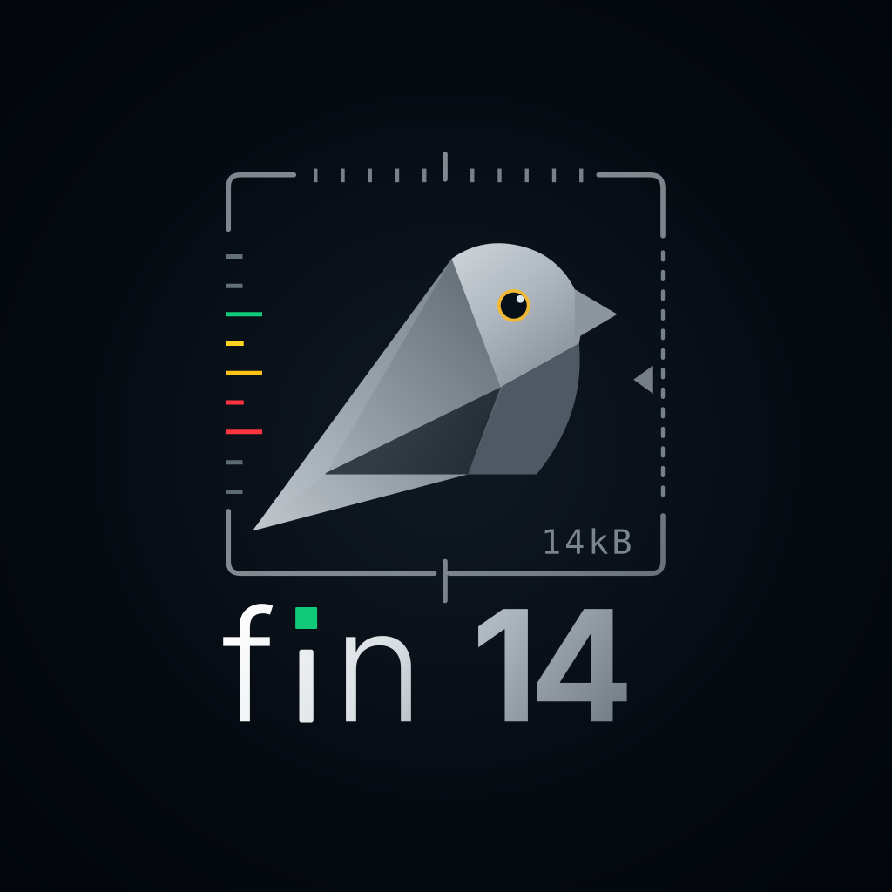
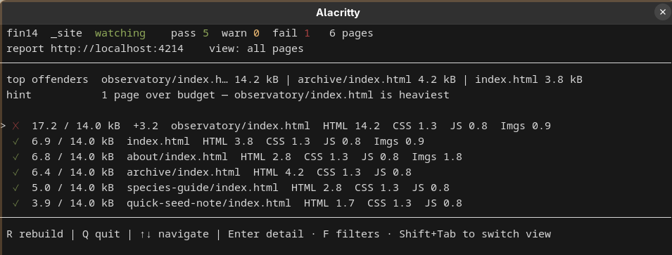
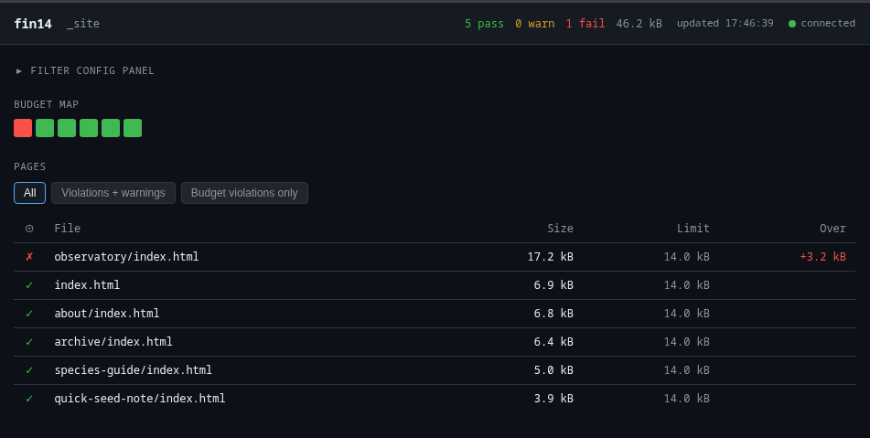
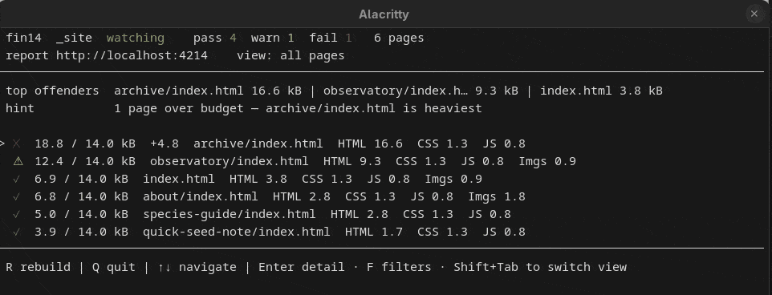
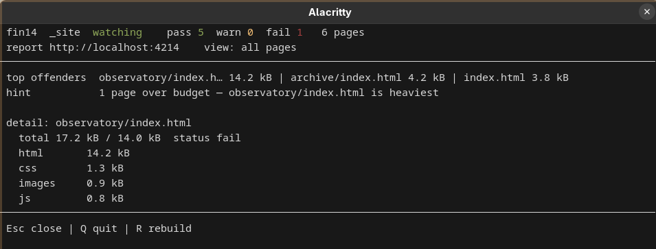
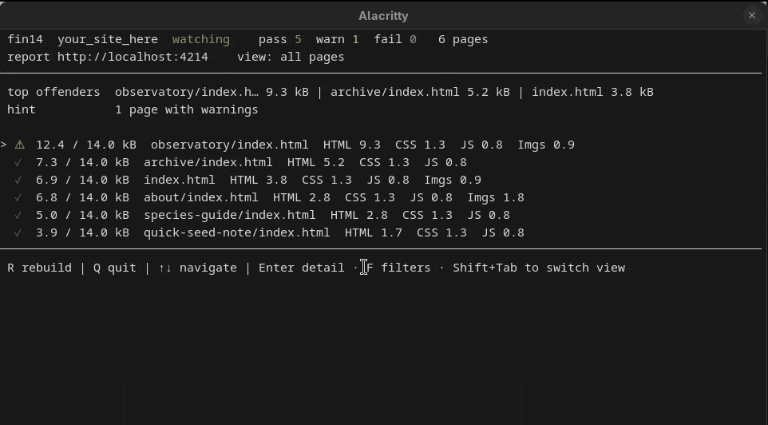
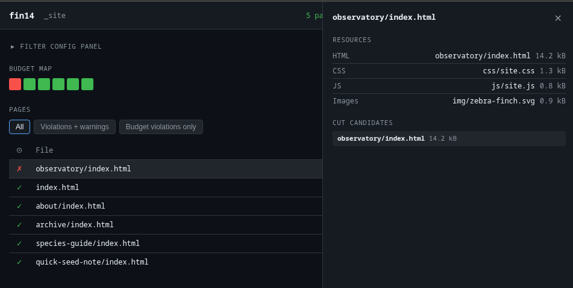

<p align="center">
  
</p>

<p align="center">14 kB budget linter for static sites</p>

<p align="center">
  <a href="https://www.npmjs.com/package/fin14"></a>
  <a href="./LICENSE"></a>
</p>

fin14 is a page weight linter for static sites. It has a TUI, Web Report and CI mode. Run `fin14 dev` and get a live budget dashboard that updates as your SSG rebuilds — gzip-compressed size for every page, in real time, with a resource breakdown. When you push, `fin14` can enforce the same 14 kB limit in CI. A page under 14 kB fits in a single TCP round-trip; fin14 keeps it there.

<table>
  <tr>
    <td align="center"><b>Terminal (TUI) — <code>fin14 dev</code></b></td>
    <td align="center"><b>Live web report</b></td>
  </tr>
  <tr>
    <td></td>
    <td></td>
  </tr>
</table>

## Install

```bash
npm install -D fin14
```

Or try it immediately — fin14 auto-detects your SSG output dir:

```bash
npx fin14
```

## See it work

`fin14 dev` watches your build and reports the same numbers two ways at once: a terminal dashboard and a live browser report at `http://localhost:4214`. Pick whichever you keep open while you work.

### Live in your terminal

Every page, ranked by weight against the budget, refreshed on each rebuild. Switch view mode with `Shift+Tab` for a cleaner view showing only warnings, or only budget violations.

<p align="center">
  
</p>

Use the arrows to select a page and press `Enter` for the full per-resource breakdown — HTML, CSS, JS, and images, with the heaviest cut candidates called out.

<p align="center">
  
</p>

Press `F` to filter which types of warnings the TUI shows you (you can also set this in `fin14.toml`).

<p align="center">
  
</p>

Keys: `R` rebuild · `Q` quit · `↑`/`↓` navigate · `Enter` detail · `F` filters · `Shift+Tab` switch view.

### Or in your browser

The **web report** shows the same data, plus a budget map. It also has status filters and a per-page panel listing every resource and its cut candidates. It updates over SSE as your site rebuilds — no reload.

<p align="center">
  
</p>

## Why 14 kB

TCP slow-start sends the first 10 packets before waiting for an acknowledgement — roughly 14 kB on a standard 1500-byte MTU. A page that fits in that initial window renders without a round-trip delay on the first exchange. fin14 measures the gzip-compressed weight of everything the browser fetches for the initial page load and fails if any page exceeds the budget.

## Works with any SSG

fin14 auto-detects your generator and output directory:

| SSG | Detected from | Output dir |
|---|---|---|
| Hugo | `hugo.toml` / `hugo.yaml` / `hugo.json` | `public/` |
| Eleventy | `.eleventy.js` / `eleventy.config.*` | `_site/` |
| Astro | `astro.config.*` | `dist/` |
| Jekyll | `_config.yml` / `_config.toml` | `_site/` |
| Next.js | `next.config.*` | `out/` |

Pass an explicit path to override detection: `fin14 dev public/`.

## Use it in CI

```yaml
- name: Build
  run: npm run build
- name: Check page budget
  run: npx fin14 --strict
```

`--strict` also fails on external CDN resources counted in the budget and pages above 12.2 kB (the IPv6 MTU heuristic: 10 × (1280 − 40 − 20) bytes).

## Any budget, not only 14 kB

Drop a `fin14.toml` at the project root for a more flexible setup:

```toml
[project]
output_dir    = "dist"          # set explicitly if auto-detection doesn't match
build_command = "npm run build" # optional: R key in dev mode triggers this

[budget]
default     = "14kb"            # 14,000 bytes; accepts integer bytes too
compression = "gzip"            # or "brotli"

[warnings]
exclude = []                    # suppress specific warning codes, e.g. ["E14"]
```

Without a config file, fin14 applies all defaults and auto-detects the output dir.

## Reference

Full command, flag, config, JSON, baseline, and GitHub Action documentation lives in the [CLI readme](./packages/cli/README.md).

## Feedback

fin14 is actively developed and pre-1.0. If you hit a bug or have an idea that would improve the UX, please [open an issue](https://github.com/duxpe/fin14/issues).

## License

MIT
